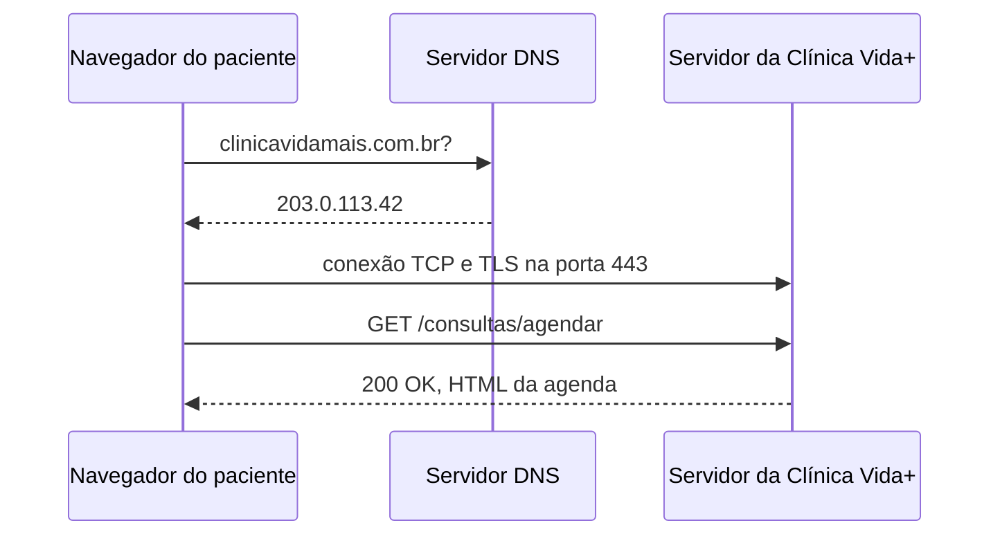

## O caminho de uma requisição

 Evidência do DNS
 DNS request timed out.
    timeout was 2 seconds.
Servidor:  UnKnown
Address:  186.251.39.123

Não é resposta autoritativa:
Nome:    github.com
Address:  4.228.31.150

Evidência do HTTP
requisição 1
github.githubassets.com/assets/64244-0b84129b40e3a01d.js
GET
200

requisição 2
github.githubassets.com/assets/98527-1d1fc5148ca48643.js
GET
200 

requisição 3

github.githubassets.com/assets/platform-4ce65ae0bf273ce2.png
GET
200

requisição 4
github.githubassets.com/assets/MonaSansVF-wdth-wght-opsz-7a868ff47c93bd97.woff2
GET
200

Por que o uso de HTTPS?
 Se faz necessário o uso de https para uma maior segurança no tráfego dos dados no site da clinica vida +, pois nosso site trata com dados delicados, tanto de pacientes quanto de médicos, como o CPF, que de acordo com LGPD deve ser cripitografado e protegido para manter a segurança do úsuario ao uso do site, e para que esses dados não sejam alterados ou interceptados durante o tráfego.